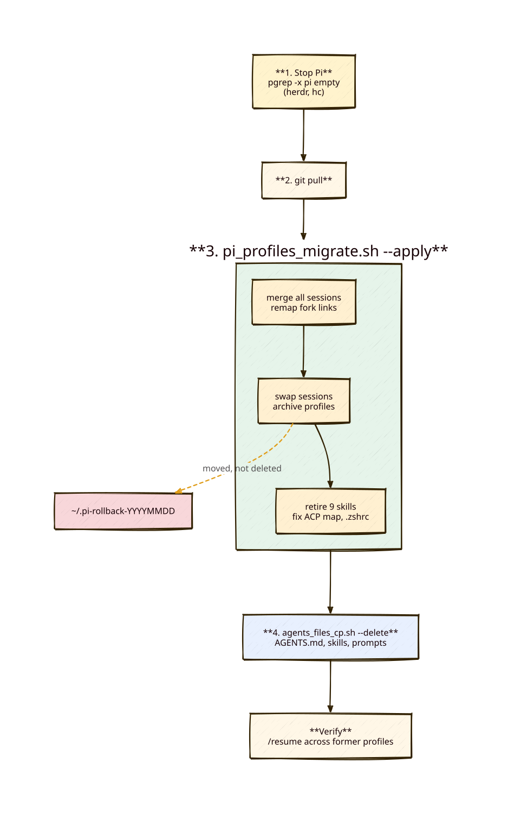

# Migrate Another Laptop off `pi-profile` (Minimal-Only Pi)

**Goal:** Retire `pi-profile` and `~/.pi/profiles/*` on another laptop so plain `pi` uses the former `minimal` configuration directly from `~/.pi/agent`, with **all profile sessions merged** (fork links preserved), private `0600` credentials intact, all companion tools (`claude`, `codex`, `gemini`, `agy`, `copilot`, `cursor`) updated, and a same-volume rollback archive.

## Diagram



---

## Key Gotchas (Read First)

1. **Hidden idling `pi` processes in Herdr:** Even after closing terminal windows, `herdr server` can hold dozens of idling `pi` processes in background sessions. Always verify `pgrep -x pi` is empty before touching `~/.pi`.
2. **Symlink trap on `auth.json` & `models.json`:** In `~/.pi/profiles/minimal/agent/`, `auth.json` and `models.json` were relative symlinks (`../../../agent/...`). Copying `minimal/agent` to `~/.pi/agent` without replacing them with regular `0600` copies from the old `~/.pi/agent/` creates broken self-referential symlinks.
3. **Do not naively `cp -r` sessions:** Pi stores absolute `parentSession` paths in `.jsonl` headers to build fork trees. Merging without remapping `~/.pi/profiles/<name>/agent/sessions/...` → `~/.pi/agent/sessions/...` breaks fork nesting. Use the merge script below.
4. **`agents_files_cp.sh` has a Main-Mac-only guard:** `agents_files_cp.sh` checks `hostname -s == MacBook-Pro`. On another laptop, either deploy from the main Mac via `agents_files_cp_remote.sh`, or sync `data-dir-agents/generated/` to each tool directory (see Step 5).
5. **Other tools carry copies of `pi-worker-runtime.sh`:** Claude, Gemini, Antigravity (`~/.gemini/config/skills`), Copilot (default + `partner`), Cursor, and Codex all have deployed copies of `sub-agent-herdr-supervisor` / `sub-agent-cmux-supervisor`. Update all of them, not just `~/.pi/agent`.
6. **Installed Git extension `pi-subagent-herdr`:** `~/.pi/agent/git/github.com/cgint/pi-subagent-herdr` has its own bundled `pi-worker-runtime.sh`. Fast-forward it to commit `fe310bd` or newer (or run `pi update --extensions`).

---

## Step-by-Step Procedure

### 1. Stop all Pi writers
Check for running `pi` processes, Herdr sessions, and Docker containers:

```bash
pgrep -x pi || echo "ZERO pi processes"
herdr session list 2>/dev/null || true
docker ps --format '{{.Names}} {{.Image}} {{.Status}}' 2>/dev/null || true
```

If idling `pi` processes remain (for example inside a Herdr session):

```bash
pkill -HUP -x pi
sleep 2
pgrep -x pi || echo "All pi processes exited cleanly"
```

Do **not** proceed until `pgrep -x pi` returns nothing.

### 2. Pull latest `dev-bin` (and external repos if present)
```bash
git -C ~/.local/bin pull --ff-only origin main
```

- If `dev-bin` is cloned elsewhere (e.g. `~/dev/dev-bin`) and on `PATH`, pull it there too and verify `pi-profile` is gone from `PATH`.
- If you have local checkouts under `~/dev-external/` or `~/dev/`, pull the updated commits:
  - `pi-subagent-herdr` (`fe310bd`+)
  - `dspy.ex` (`9d64ab4`+)
  - `pi-mini-self-org` (`0dde714`+)
  - `pi-agent-docker` (`779d04f`+)

### 3. Stage the new `~/.pi/agent` and merge all sessions
Save the self-contained `merge_pi_history.py` script from the collapsible section at the bottom of this file to `/tmp/merge_pi_history.py`, then run:

```bash
set -euo pipefail
pgrep -x pi >/dev/null 2>&1 && { echo "ABORT: pi is still running" >&2; exit 1; }

STAGE=$(mktemp -d "$HOME/.pi-cutover-live.XXXXXX")
chmod 700 "$STAGE"
echo "STAGE=$STAGE"

# 1. Copy minimal/agent (excluding sessions)
rsync -a --exclude='/sessions' "$HOME/.pi/profiles/minimal/agent/" "$STAGE/agent/"

# 2. Replace auth.json & models.json symlinks with regular 0600 copies from old ~/.pi/agent
for f in auth.json models.json; do
  rm -f "$STAGE/agent/$f"
  cp -p "$HOME/.pi/agent/$f" "$STAGE/agent/$f"
  chmod 600 "$STAGE/agent/$f"
  test ! -L "$STAGE/agent/$f" && test -f "$STAGE/agent/$f"
done

# 3. Merge all session roots (default + all profiles) and remap fork parentSession links
uv run python /tmp/merge_pi_history.py "$HOME/.pi" "$STAGE/agent/sessions" | tee "$STAGE/merge_result.json"

# 4. Verify zero broken symlinks in staged agent
find "$STAGE/agent" -maxdepth 4 -not -path '*/node_modules/*' -type l ! -exec test -e {} \; -ls
```

Check the printed JSON counts (`sessions_by_source`, `remapped`). The script verifies every file's payload hash, mtime, unique session ID, and unchanged source inventory before exiting `0`.

### 4. Atomic same-volume swap (with rollback archive)
Replace `STAGE` with the directory printed in Step 3:

```bash
set -euo pipefail
STAGE="$HOME/.pi-cutover-live.XXXXXX"   # <-- set from Step 3
ROLLBACK="$HOME/.pi-rollback-$(date +%Y%m%d)"

pgrep -x pi >/dev/null 2>&1 && { echo "ABORT: pi is still running" >&2; exit 1; }
test -d "$STAGE/agent/sessions"
test ! -e "$ROLLBACK"
mkdir -m 700 "$ROLLBACK"

cp -p "$HOME/.zshrc" "$ROLLBACK/zshrc.bak" 2>/dev/null || true

rollback() {
  echo "ERROR during swap — rolling back!" >&2
  [ -d "$HOME/.pi/agent" ] && [ ! -e "$STAGE/agent" ] && mv "$HOME/.pi/agent" "$STAGE/agent" || true
  [ -d "$ROLLBACK/agent" ] && [ ! -e "$HOME/.pi/agent" ] && mv "$ROLLBACK/agent" "$HOME/.pi/agent" || true
  [ -d "$ROLLBACK/profiles" ] && [ ! -e "$HOME/.pi/profiles" ] && mv "$ROLLBACK/profiles" "$HOME/.pi/profiles" || true
  exit 1
}
trap rollback ERR

mv "$HOME/.pi/agent" "$ROLLBACK/agent"
mv "$HOME/.pi/profiles" "$ROLLBACK/profiles"
mv "$STAGE/agent" "$HOME/.pi/agent"
trap - ERR
echo "Swap complete. Rollback archive: $ROLLBACK"
```

### 5. Deploy canonical generated files to all tools
Choose the option that matches this laptop:

- **Option A — Run local deploy directly on this laptop:**
  If this laptop is managed locally from `~/.local/bin` (not via `agents_files_cp_remote.sh` from the main Mac), run:
  ```bash
  AGENTS_FILES_CP_HOSTNAME=MacBook-Pro ~/.local/bin/agents_files_cp.sh --delete
  ```
  This mirrors `data-dir-agents/generated/` into `~/.pi/agent`, `~/.claude`, `~/.codex`, `~/.gemini`, `~/.gemini/config/skills`, `~/.copilot`, `~/.copilot/profiles/partner`, and `~/.cursor` without recreating `~/.pi/profiles`.
- **Option B — Push from the main Mac:**
  If this laptop has a host TOML under `data-dir-agents/definitions/hosts/`, run `./agents_files_cp_remote.sh --host <laptop> --apply` and `--agy-only --apply` from the main Mac, and sync `~/.claude`, `~/.gemini`, `~/.copilot`, `~/.cursor` if those tools are installed.

### 6. Update installed `pi-subagent-herdr` & shell dotfiles
1. **Update installed `pi-subagent-herdr`:**
   ```bash
   git -C "$HOME/.pi/agent/git/github.com/cgint/pi-subagent-herdr" pull --ff-only origin master
   # or: pi update --extensions
   ```
2. **Clean `~/.zshrc` (and `~/.bashrc` if present):**
   Remove `pi-profile` aliases and any `PI_WORKER_PROFILE=...` exports; keep plain `pi` aliases:
   ```diff
    alias pir="pi --dm-read"
    alias pis="pi --append-system-prompt ~/.pi/agent/skills/grounded-pairing-discipline/SKILL.md"
    alias pisr="pi --dm-read --append-system-prompt ~/.pi/agent/skills/grounded-pairing-discipline/SKILL.md"
   -alias pipa="pi-profile partner"
   -alias pipas="pi-profile partner --append-system-prompt ~/.pi/agent/skills/grounded-pairing-discipline/SKILL.md"
   -alias pipasr="pi-profile partner --dm-read --append-system-prompt ~/.pi/agent/skills/grounded-pairing-discipline/SKILL.md"
   -alias pim="pi-profile minimal"
   -alias pims="pi-profile minimal --append-system-prompt ~/.pi/profiles/minimal/agent/AGENTS.md"
   -alias pimsg="pi-profile minimal --append-system-prompt ~/.pi/profiles/minimal/agent/AGENTS.md -e npm:@capyup/pi-goal"
   -alias pimsr="pi-profile minimal --dm-read --append-system-prompt ~/.pi/profiles/minimal/agent/AGENTS.md"
   +alias pig="pi -e npm:@capyup/pi-goal"
   -alias piparlm="pi-profile partner --rlm -e ~/dev-external/pi-rlm/src/extension/index.ts"
   -alias pimsrlm="pi-profile minimal --append-system-prompt ~/.pi/profiles/minimal/agent/AGENTS.md --rlm -e ~/dev-external/pi-rlm/src/extension/index.ts"
   ```
   Validate syntax: `zsh -n ~/.zshrc` (and `bash -n ~/.bashrc` if edited).

---

## Verification Checklist

Run all checks after cutover:

```bash
set -e
test ! -e "$HOME/.pi/profiles"
! command -v pi-profile >/dev/null 2>&1
test -f "$HOME/.pi/agent/auth.json" && test ! -L "$HOME/.pi/agent/auth.json"
test -f "$HOME/.pi/agent/models.json" && test ! -L "$HOME/.pi/agent/models.json"
stat -f '%Sp %N' "$HOME/.pi/agent/auth.json" "$HOME/.pi/agent/models.json"
find "$HOME/.pi/agent" -maxdepth 4 -not -path '*/node_modules/*' -type l ! -exec test -e {} \; -ls
pi --version
pi auth check --provider openai-codex
pi --list-models | head -12

# Verify zero stale pi-profile hits in deployed tool skills (ignoring the exit-83 poison-pill test)
for d in ~/.pi/agent/skills ~/.claude/skills ~/.gemini/skills ~/.gemini/config/skills ~/.copilot/skills ~/.copilot/profiles ~/.cursor/skills ~/.codex/dev-bin ~/.pi/agent/git/github.com/cgint/pi-subagent-herdr/skills; do
  [ -d "$d" ] || continue
  rg -l 'pi-profile' "$d" 2>/dev/null | grep -v 'test_worker_launchers.sh' && exit 1 || echo "CLEAN: $d"
done

# Verify dotfiles clean
! rg -n 'pi-profile|PI_WORKER_PROFILE|\.pi/profiles' ~/.zshrc ~/.zshenv ~/.zprofile ~/.bashrc ~/.bash_profile 2>/dev/null
```

Also open `pi` interactively once in a project with history from multiple former profiles and verify:
- `/resume` (session picker) shows sessions from all former profiles and preserves fork nesting.
- `pi -c` resumes the most recent session across the merged history.

---

## Rollback

Keep `$HOME/.pi-rollback-YYYYMMDD` until you are comfortable with daily `pi` usage. To roll back:
1. Stop all `pi` processes (`pgrep -x pi` empty).
2. Move `~/.pi/agent` to `~/.pi/agent.failed`, move `$ROLLBACK/agent` → `~/.pi/agent` and `$ROLLBACK/profiles` → `~/.pi/profiles`, and restore `$ROLLBACK/zshrc.bak` → `~/.zshrc`.

---

## Self-Contained Session Merge Script (`merge_pi_history.py`)

<details>
<summary>Click to expand <code>merge_pi_history.py</code> (save to <code>/tmp/merge_pi_history.py</code>)</summary>

```python
"""Merge Pi session history from ~/.pi/agent and ~/.pi/profiles/*/agent into a new staging directory."""

import argparse
from collections import Counter
from dataclasses import dataclass
from itertools import zip_longest
import json
import os
from pathlib import Path
import shutil
import stat


@dataclass(frozen=True)
class Entry:
    path: Path
    relative: Path
    root: Path
    metadata: tuple[int, ...]
    session_id: str | None
    parent: str | None


def signature(info):
    return (info.st_dev, info.st_ino, info.st_size, info.st_mode, info.st_mtime_ns, info.st_ctime_ns)


def inventory(roots):
    entries = []
    for root in roots:
        if not root.exists():
            continue
        if root.is_symlink():
            raise ValueError("A session root is a symlink")
        for path in sorted(root.rglob("*")):
            info = path.lstat()
            if stat.S_ISDIR(info.st_mode):
                continue
            if not stat.S_ISREG(info.st_mode):
                raise ValueError("A session tree contains a non-regular file")
            session_id = None
            parent = None
            if path.suffix == ".jsonl":
                with path.open("rb") as source:
                    header = json.loads(source.readline())
                    if signature(os.fstat(source.fileno())) != signature(info):
                        raise ValueError("A source file changed during inventory; retry when Pi is stopped")
                if header.get("type") == "session":
                    session_id = header.get("id")
                    parent = header.get("parentSession")
                    if not isinstance(session_id, str) or (parent is not None and not isinstance(parent, str)):
                        raise ValueError("Invalid Pi session header")
            entries.append(Entry(path, path.relative_to(root), root, signature(info), session_id, parent))
    return entries


def rewrite_header(header, parent):
    data = json.loads(header)
    data["parentSession"] = parent
    newline = b"\r\n" if header.endswith(b"\r\n") else b"\n"
    return json.dumps(data, ensure_ascii=False, separators=(",", ":")).encode() + newline


def chunks(stream):
    return iter(lambda: stream.read(1024 * 1024), b"")


def merge_history(roots, output, final_root):
    if output.exists() or output.is_symlink():
        raise ValueError("Choose a new output directory")
    if any(output.is_relative_to(root) or root.is_relative_to(output) for root in roots):
        raise ValueError("Staging must be separate from the source session trees")

    entries = inventory(roots)
    destinations = {}
    session_ids = set()
    for entry in entries:
        folded = str(entry.relative).casefold()
        if folded in destinations:
            raise ValueError("A relative session file path would be overwritten")
        destinations[folded] = entry
        if entry.session_id is not None:
            if entry.session_id in session_ids:
                raise ValueError("A Pi session ID occurs more than once")
            session_ids.add(entry.session_id)
    for entry in entries:
        if any(str(folder).casefold() in destinations for folder in entry.relative.parents):
            raise ValueError("A file would hide a session directory")

    final_paths = {
        str(entry.path): str(final_root / entry.relative)
        for entry in entries if entry.session_id is not None
    }
    remapped = 0
    output.mkdir(parents=True, mode=0o700)
    for entry in entries:
        dest = output / entry.relative
        dest.parent.mkdir(parents=True, exist_ok=True)
        parent = final_paths.get(os.path.normpath(entry.parent)) if entry.parent else None
        new_parent = parent if parent != entry.parent else None
        with entry.path.open("rb") as source, dest.open("xb") as target:
            if signature(os.fstat(source.fileno())) != entry.metadata:
                raise ValueError("A source file changed before copying")
            if new_parent:
                target.write(rewrite_header(source.readline(), new_parent))
                remapped += 1
            shutil.copyfileobj(source, target)
        shutil.copystat(entry.path, dest)
        if dest.stat().st_mtime_ns != entry.metadata[4]:
            raise ValueError("A destination timestamp differs")
        with entry.path.open("rb") as source, dest.open("rb") as target:
            if new_parent:
                if target.readline() != rewrite_header(source.readline(), new_parent):
                    raise ValueError("A migrated fork header differs")
            if any(a != b for a, b in zip_longest(chunks(source), chunks(target))):
                raise ValueError("A destination payload differs")
            if signature(os.fstat(source.fileno())) != entry.metadata:
                raise ValueError("A source file changed while being copied")

    if entries != inventory(roots):
        raise ValueError("The source inventory changed; make a new stage after all writers have stopped")
    counts = Counter("default" if entry.root == roots[0] else entry.root.parent.parent.name
                     for entry in entries if entry.session_id is not None)
    return {
        "files": len(entries),
        "sessions": len(session_ids),
        "sessions_by_source": dict(counts),
        "remapped": remapped,
    }


def main():
    parser = argparse.ArgumentParser(description=__doc__)
    parser.add_argument("pi_home", type=Path)
    parser.add_argument("staged_sessions", type=Path)
    args = parser.parse_args()
    pi_home = args.pi_home.resolve()
    dest = args.staged_sessions.absolute()
    if dest.is_relative_to(pi_home):
        parser.error("staging must be outside the active Pi home")
    default = pi_home / "agent" / "sessions"
    roots = [default]
    profiles = pi_home / "profiles"
    if profiles.is_dir():
        for profile in sorted(profiles.iterdir()):
            if profile.is_symlink() or (profile / "agent").is_symlink():
                parser.error("profile directories must not be symlinks")
            if profile.is_dir():
                roots.append(profile / "agent" / "sessions")
    print(json.dumps(merge_history(roots, dest, default), sort_keys=True))


if __name__ == "__main__":
    main()
```

</details>
