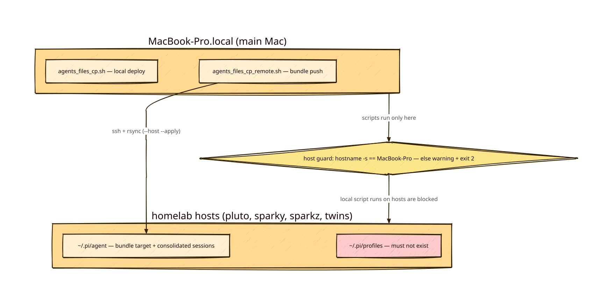

# PLAN: Mac-only deploy + host profile cleanup

as-of: 2026-11-08 · repo: `~/dev/dev-bin` (main)

## Status

**Implemented and verified (2026-11-08):** host guard in both deploy scripts (TDD red→green); pluto refusal verified live (exit 2, warning, no state change, `--help` works); pluto host cleanup done (4 profile sessions consolidated into `~/.pi/agent/sessions/`, `~/.pi/profiles` removed). Remaining: user-gated purge of `~/.pi-profiles.removed-20261108`. No host besides pluto was affected.

Unrelated pre-existing test failures on pluto (not touched by this change): `tests/md2html.test.sh` (pandoc 3.7 rejects `--syntax-highlighting`), `tests/watchdiff.test.sh` (`state/ready` timeout).

**Recreator found + fixed (2026-11-08 16:35):** herdr worker launches on pluto (`herdr-worker.sh` → `pi-worker-runtime.sh`) prefer `pi-profile minimal` whenever `pi-profile` is on PATH (it is — dev-bin is on PATH); this recreated `~/.pi/profiles/minimal` at 16:25 and blocked all herdr workers with `required trusted extension not found`. Fix: `export PI_WORKER_PROFILE=default` in pluto's `~/.bashrc` (the runtime's designed env override — no repo edits) → workers resolve to `~/.pi/agent`, where `herdr-agent-state.ts` exists; simulated worker launch passes the extension check. Second recreation renamed away to `~/.pi-profiles.recreated-20261108`.

Residual (upstream pi-subagent-herdr, Mac-only by design): `orca-herdr-pi-start-named-session.sh:248` hardcodes `pi-profile minimal`; `test_worker_launchers.sh` covers profile behavior — hosts must keep pinning `PI_WORKER_PROFILE=default`.

## Diagram

## Goal / success criteria (falsifiable)

1. `agents_files_cp.sh` with `hostname -s` != `MacBook-Pro` → non-zero exit, warning on stderr naming allowed host + detected host + correct alternative; **no state change** (no dirs created, generator not run).
2. Same for `agents_files_cp_remote.sh`.
3. `-h/--help` still works on any host (guard sits after arg parsing).
4. `bash test_agents_files_cp.sh` and the new remote-guard test pass on pluto (hostname injected in tests).
5. Non-Mac hosts: no `~/.pi/profiles`; any profile session jsonl consolidated into `~/.pi/agent/sessions/<project>/`.
6. Quarantine `~/.pi-profiles.removed-20261108` purged (user-gated).

## Evidence (2026-11-08)

- Host TOMLs (pluto/sparky/sparkz/twins) all deploy to `~/.pi/agent` — remote pushes never create `~/.pi/profiles` (`data-dir-agents/definitions/hosts/*.toml`).
- Local `agents_files_cp.sh` deploys pi-agent profiles: default → `~/.pi/agent`; minimal/opsx/partner/zero → `~/.pi/profiles/<name>/agent` (`generated/pi-agent-profiles/*/.target`). Running it on pluto is what created the profiles mess.
- ssh probe: sparky, sparkz, twins have **no** `~/.pi/profiles`. Only pluto was affected.
- Pluto cleanup (done): 4 minimal-profile session jsonl moved to `~/.pi/agent/sessions/{--mnt-server-LOCAL-app-data-litellm-test--,--mnt-server-RAID1-cgint_data-dev-external-pi-subagent-herdr--}` (integrity-checked, no collisions); `~/.pi/profiles` quarantine-moved to `~/.pi-profiles.removed-20261108`.
- Attribution: script predates `~/.pi` sessions (initial snapshot 2026-03-05; earliest session 2026-08-30) — authoring not attributable from `~/.pi`. Pluto rollout: homelab session `glm-5.3-flash-direct` (home-llm) deployed/inspected 11:44–11:57; stray profile sessions were run by `qwen3.8-27b-direct` (home-llm) (model field in the moved files).
- Repo has unrelated dirty files (`md2html`, `README.html`) — untouched.

## Design decisions

- Guard: `hostname -s` must equal `MacBook-Pro` (short name, robust to `.local`/`.lan` suffix changes). Constant `ALLOWED_HOST="MacBook-Pro"`.
- Testability: `AGENTS_FILES_CP_HOSTNAME` env var overrides detection (documented as test injection, not a supported bypass).
- Placement: after argument parsing, before any state change (before `propagate_definitions.py --apply`; before staging/ssh in the remote script).
- Message idiom: `echo "ERROR: ..." >&2` + `exit 2`, matching existing style; usage() help text states "main Mac (MacBook-Pro.local) only".
- Remote script's warning points to itself as the correct tool; local script's warning points to `agents_files_cp_remote.sh --host <host> --apply` from the main Mac.

## Implementation plan

1. TDD red: extend `test_agents_files_cp.sh` with guard tests (injected non-Mac hostname; existing assertions switched to injected `AGENTS_FILES_CP_HOSTNAME=MacBook-Pro`). Add `tests/agents_files_cp_remote-guard.test.sh` (guard-only; refuses before any ssh). ✓ 2026-11-08
2. Implement guard in both scripts. ✓ 2026-11-08
3. Green: both test files pass; `--help` sanity + live refusal on pluto captured. ✓ 2026-11-08
4. Purge `~/.pi-profiles.removed-20261108` (only after user OK). — pending
5. Path-scoped commit: `agents_files_cp.sh`, `agents_files_cp_remote.sh`, `test_agents_files_cp.sh`, `tests/agents_files_cp_remote-guard.test.sh`, `PLAN-mac-only-deploy.{md,d2,svg}`. ✓ 2026-11-08

## Verification plan

- Both test files pass; refusal/acceptance behavior demonstrated with injected hostnames.
- Per-host check `ls -d ~/.pi/profiles` → absent (already verified sparky/sparkz/twins 2026-11-08; pluto locally).
- Moved sessions still load (valid JSONL last lines, present in main store).

## Open questions

- Assumption: profiles stay wanted **on the Mac** (`agents_files_cp.sh` still deploys `~/.pi/profiles/*` there). Dropping them on the Mac too = definitions-level change package (separate).
- Purge timing for the quarantine copy.
- Residual recreators on hosts: any `pi --profile X` run on a host re-creates a profile data dir — out of scope (usage-side).
