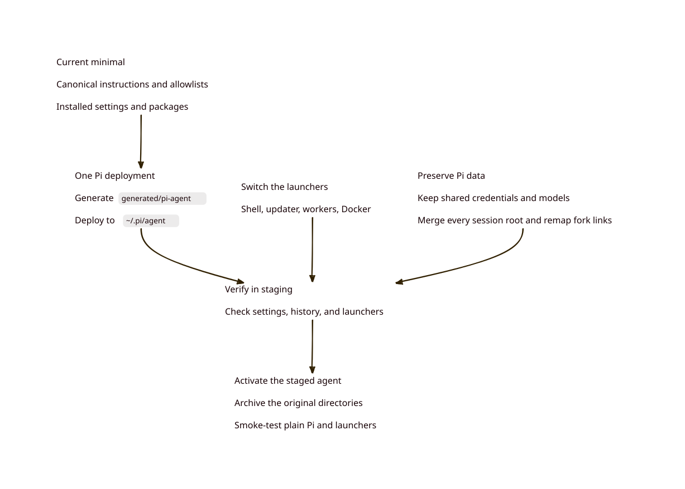

# Make minimal the single Pi configuration

**Status as of 2026-11-22: LIVE CUTOVER COMPLETE.** Plain `pi` now loads the canonical minimal configuration from `~/.pi/agent` with all 5,713 sessions merged (87 fork links remapped) and private `0600` credentials. Rollback archive preserved at `/Users/cgint/.pi-rollback-20261122`. `~/.zshrc`, `pi-agent-docker`, `dspy.ex`, and `pi-subagent-herdr` (including its live `~/.pi/agent/git/` copy) are updated and verified.

## Diagram

## Staging results

- The rehearsal preserved 5,662 session files and five companion files, with 87 fork links remapped. Pi's native picker found all 5,529 per-project sessions. The remaining 133 are nested session files, kept in their original relative locations. The real session trees were read only. [Rehearsal counts](/Users/cgint/.pi-cutover.ouLyatPp/rehearsal.json) · [Merge utility](/Users/cgint/.pi-cutover.ouLyatPp/merge_pi_history.py)
- Verified the generator, repeat deployment, Herdr worker launchers, Antigravity deployment, shell syntax, and both Herdr Docker Compose configurations. No Herdr container image was built or launched. The staged Pi home and an independent copy of `minimal` gave identical offline startup warnings and selected `google/gemini-4-neon` at medium thinking. The saved settings still specify `openai-codex/gpt-5.5` at medium thinking.
- The live Pi directories, aliases, and wrapper remain in place. Before activation, refresh the rehearsal from the live sources after writers stop, recheck current code bases and saved Herdr restore metadata, and roll back launcher changes together with the directories if activation fails. [Local source worktree](/Users/cgint/.pi-cutover.ouLyatPp/bin-worktree) · [Herdr container worktree](/Users/cgint/.pi-cutover.ouLyatPp/herdr-container-worktree) · [Proposed alias changes](/Users/cgint/.pi-cutover.ouLyatPp/zshrc.proposed)

## What is installed

Pi 1.6.0 on this Mac is `@earendil-works/pi-coding-agent`. Its installed [`getAgentDir()`](/opt/homebrew/lib/node_modules/@earendil-works/pi-coding-agent/dist/config.js:510) resolves to `~/.pi/agent` by default. `pi-profile` selects another directory using Pi's native `PI_CODING_AGENT_DIR` override. Docker and test fixtures can use that override to specify their own filesystem paths. [pi-profile](./pi-profile#L111)

| Installed agent directory | Default model and thinking | Session files at first snapshot |
| --- | --- | ---: |
| `~/.pi/agent` | `google/gemini-3.5-flash`, off | 976 |
| `~/.pi/profiles/minimal/agent` | `openai-codex/gpt-5.5`, medium | 2,952 |
| `~/.pi/profiles/partner/agent` | `olla/qwen3.8-27b-nvfp4-dflash2`, off | 1,706 |
| `~/.pi/profiles/zero/agent` | `openai-codex/gpt-5.5`, medium | 26 |
| `~/.pi/profiles/opsx/agent` | No settings file | 0 |

- **Instructions and skills.** Installed `minimal/agent/AGENTS.md` matches generated `minimal`. The two live trees have the same five prompt files, byte for byte. Base has 37 managed skill directories and minimal has 27. Minimal's manifest names 28 skills, including `tldr`, whose source directory is absent. Both trees' markers record their old deployment identities. Installed packages can contribute additional skills and prompts. [Minimal manifest](./data-dir-agents/definitions/profiles/pi-agent/minimal.toml) · [Skill sync](./agents_files_cp.sh#L96)
- **Settings and extensions.** Minimal has 15 model entries and nine package entries. Base has 38 model entries. Both have the same `defaultTools` setting. Minimal uses the Git build of `pi-web-access` and base uses npm. The eight common Git package checkouts have the same recorded commits. Minimal has one loose extension, the Herdr reporter, whose bytes differ from the base reporter. Base has ten other loose extensions and its own MCP configuration. Copying `settings.json` alone would leave these differences in effect. [Base agent](/Users/cgint/.pi/agent) · [Minimal agent](/Users/cgint/.pi/profiles/minimal/agent)
- **Credentials and history.** Minimal and partner link `auth.json` and `models.json` to the base's real files. Zero links the model file and has independent auth. Its auth store has no provider keys unique to zero and one overlapping entry with a different value. A snapshot found zero overlapping relative paths across the five session roots, but file counts grew during inspection and dozens of Pi processes were present. A subsequent header-only audit of 5,662 session files found no duplicate IDs and 87 absolute parent links into `~/.pi/profiles`. Every one had a matching file. Pi uses those paths to build the fork tree in its session selector. [Session manager](/opt/homebrew/lib/node_modules/@earendil-works/pi-coding-agent/dist/core/session-manager.js:1269) · [Session selector](/opt/homebrew/lib/node_modules/@earendil-works/pi-coding-agent/dist/modes/interactive/components/session-selector.js:153)
- **Other local state.** Base and minimal have distinct trust files, local logs, and generated state. Use minimal's trust decisions as the starting point and keep old trust and MCP files in the rollback copy for selective restoration. `~/.pi/olla` and `~/.pi/paperclips` are separate top-level directories. The Olla settings had no profile path. Paperclips contains JSONL records and its runtime coupling was not established. [Pi home](/Users/cgint/.pi)

## What would recreate profiles or break

| Surface | Observed dependency |
| --- | --- |
| Generation and deploy | The generator emits `generated/pi-agent-profiles/<name>` and `.target` files. `agents_files_cp.sh` loops over them. `pi-setup.sh` has a separate profile deployment loop. The generator's old base skill/prompt planners are unused, so removing profile generation alone leaves Pi without a generated payload. [Generator](./data-dir-agents/propagate_definitions.py#L570) · [Deploy](./agents_files_cp.sh#L245) · [Setup](./pi-setup.sh#L136) |
| Shell, updater, Orca | Nine `.zshrc` aliases use `pi-profile`. Some append minimal's `AGENTS.md` explicitly, even though installed Pi already loads it as global context. Orca has a hardcoded old home path. The Mac updater uses `pi-profile --update-all`. [Shell aliases](/Users/cgint/.zshrc:24) · [Orca](./orca-herdr-pi-start-named-session.sh#L248) · [Updater](./cgi_update_mac_stuff.sh#L9) |
| Workers | The shared CMUX/Herdr runtime picks `pi-profile` when available and uses the selected directory for the Herdr reporter. The `pi-subagent-herdr` package in minimal ships its own supervisor skill and a separate profile-aware launcher. That launcher falls back to ordinary Pi with the default environment, and explicit named `PI_WORKER_PROFILE` values can still fail. [Shared runtime](./data-dir-agents/definitions/runtime/pi-worker-runtime.sh#L5) · [Package runtime](/Users/cgint/dev-external/pi-subagent-herdr/skills/subagent-herdr-supervision/scripts/pi-worker-runtime.sh:9) |
| Saved Herdr sessions | Current saved state and historical snapshots contain profile path or launcher references. Validate active restore paths before reopening panes after cutover. [Herdr state directory](/Users/cgint/.config/herdr) |
| Docker | `pi-docker` delegates to a separate checkout. Its one-off launcher defaults to `partner` and mounts base read-only plus the selected profile read-write. The Herdr shell and both Compose configurations mount the entire Pi home writable. Their packaged supervisor expects its reporter under `/root/.pi/agent`. The one-off image uses Node 20 and the old Pi package. The Docker repo documents Node 22 requirements for the newer package. [One-off launcher](/Users/cgint/dev/pi-agent-docker/run.sh:56) · [Herdr entrypoint](/Users/cgint/dev/pi-agent-docker/herdr-entrypoint.sh:4) · [Image notes](/Users/cgint/dev/pi-agent-docker/NOTES.md:250) |
| Remote deployment | All four host definitions already target `~/.pi/agent` with their own allowlists. The host-state probe still checks a profile glob. Previous notes record a Pluto `PI_WORKER_PROFILE=default` export. Current remote state was not checked. [Remote deploy](./agents_files_cp_remote.sh#L124) · [Host probe](./data-dir-agents/definitions/hosts/host_state.sh#L61) · [November notes](./PLAN-mac-only-deploy.md#L11) |

## Proposed cutover

1. **Give Pi one canonical definition.** Use `definitions/pi-agent.toml` with the minimal instructions source and asset allowlists. Generate `generated/pi-agent/{AGENTS.md,skills,prompts}` and deploy it directly to `~/.pi/agent`. Remove the five Pi TOMLs, Pi profile generation, and `.target` handling for Pi. Keep Copilot's profile machinery and the host bundle allowlists. Drop the stale `tldr` entry, validate the new allowlists, and check how the `firstmate` instruction should resolve. The managed skill `firstmate` and the packaged `subagent-firstmate` have different names. The local copy of `pi-setup.sh` points to an external workspace. Remove its profile loop and retain direct-copy support, with a syntax check and no live npm install. Update the pipeline and target docs and regenerate from source.
2. **Update each local launcher before retiring the wrapper.** Have the Mac updater run `pi update --extensions` after npm updates the binary. Drop profile-only aliases and preserve useful flags such as `--dm-read`, goal, and RLM on plain Pi commands. Remove Orca's absolute prompt path and verify its three marked integration extensions during staging. Update the shared worker runtime, tests, docs, and deployed copies. Derive reporter paths from Pi's effective agent directory. During transition, accept an unset or `default` `PI_WORKER_PROFILE` for the documented Pluto configuration and reject named values with a migration error. Verify the packaged `pi-subagent-herdr` supervisor's existing plain-Pi fallback at `$HOME/.pi/agent`. Remove `pi-profile` once local callers have switched. Remove the package's optional support separately after cutover and verify the updated Git package reaches installed copies.
3. **Prepare the Herdr containers separately.** Mount the canonical agent at `/root/.pi/agent` for Herdr and Herdr web and use Pi's native default there. This keeps the packaged supervisor's reporter lookup working without a package release. Verify package resolution from Linux and recreate any affected containers in the cutover window. The one-off `pi-docker` launcher is rarely used, so its migration and auth choice are deferred. Its existing profile-based command will need an update before it can run after cutover.
4. **Stage a full copy of minimal's agent tree on the same volume.** Use it as the starting point so minimal's loose extensions, package checkouts, and other local resources come with it. Replace its relative `auth.json` and `models.json` symlinks with private regular-file copies from the old default and verify permissions are `0600`. Deploy the new managed files and markers to staging. Check the agent-root npm manifest, lockfile and `node_modules` pinned at Pi 0.84.2. Archive them if the staged 1.6.0 loader and package checks confirm they are dispensable. Host Pi aliases or embeds its extension APIs, so normal Node lookup by itself does not establish which API the installed loader uses. Test external dependencies separately. Preserve or reinstall the Orca-managed extensions if needed for the launcher to work. [Extension loader](/opt/homebrew/lib/node_modules/@earendil-works/pi-coding-agent/dist/core/extensions/loader.js:494)
5. **Merge all five session roots into the staged agent's `sessions/`.** Preserve the per-project directory, filename, session ID, and modification time of every file. Recheck the final inventory after all Pi processes and dependent containers have stopped. Stop the cutover on any unresolved file or ID collision. Remap `parentSession` headers to verified final paths, including links across former profiles. Preserve the remainder of each file byte for byte and retain the original headers in the rollback archive. Verify counts per source, destination paths, IDs, timestamps, payload hashes, and all remapped links before activating the staged tree.
6. **Switch directories with automatic rollback on failure.** Confirm the stopped writer inventory and recheck for changes since the staged merge. Check saved Herdr panes and container restart settings for legacy references. While clients remain stopped, rename the old `agent` and `profiles` directories into a private same-volume rollback directory with their original relative layout, then rename the staged tree to `~/.pi/agent`. Restore original paths if the switch fails. Keep any new sessions or credential refreshes if rolling back after starting Pi again. Permanent archive deletion is a separate decision.

## Acceptance checks

- In a temporary home, generation and local deploy produce one Pi config, are repeatable, and create no `~/.pi/profiles`. Cover legacy ownership markers and unrelated files. Run `data-dir-agents/test_propagate_definitions.py`, `test_agents_files_cp.sh`, the Herdr supervisor's `scripts/test_worker_launchers.sh`, and shell syntax checks. Retire the profile-wrapper test with its wrapper.
- Plain `pi` matches the existing minimal baseline for effective model selection and loads its instructions, tools, assets, and packages. Select sessions from every nonempty source in the normal picker and check fork nesting. In a project shared by multiple originals, verify `pi -c` chooses the most recent session across the merged history. Verify Orca, Herdr, CMUX, the Herdr containers, and the remaining aliases launch using the intended configuration. Check worker model probes, Herdr lifecycle reports, and a saved-pane restore.
- Audit active scripts, config, generated outputs, and deployed worker copies for profile selectors. The packaged `pi-subagent-herdr` compatibility branch is covered by the subsequent cleanup. Retain historical references as records. Run a second deploy and check that the profile tree does not reappear. Review generated diffs including any unrelated drift before staging repo changes.
