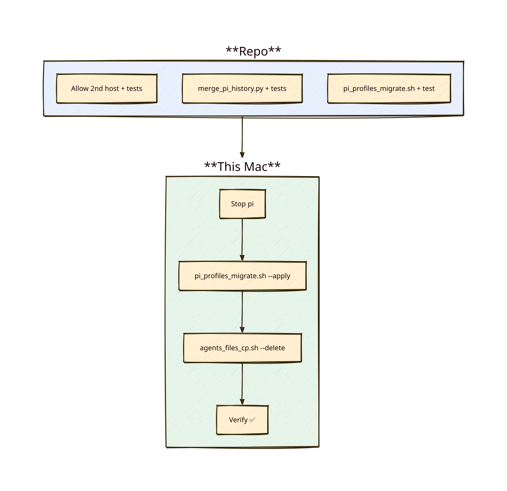

# Second Mac — Pi profile removal

- **as-of:** 2026-11-24
- **Status:** ✅ Done. This Mac runs plain `pi` from `~/.pi/agent`; `~/.pi/profiles` retired. Procedure: [MIGRATION-remove-pi-profiles.md](./MIGRATION-remove-pi-profiles.md).

## Diagram

## Decisions

| Decision | Why |
|---|---|
| Keep `~/.pi/agent` config (`settings.json`, `models.json`, auth, extensions); merge **only sessions** | Simpler and lower risk than copying the `minimal` profile over (user decision) |
| `agents_files_cp.sh` admits `ALLOWED_HOSTS=(MacBook-Pro christian.gintenreiter-smec)`, full or short-name match, single hostname source | Second Mac must deploy locally; bare short name `christian` refused as too generic; main Mac behaviour unchanged; remote driver stays main-Mac-only |
| Session merge as committed tool `merge_pi_history.py` (+ tests) | Fork `parentSession` headers are absolute paths and must be remapped |
| Cutover as `pi_profiles_migrate.sh` (preflight by default, `--apply`, moves only) | No pasted `set -e` blocks; rollback archive for everything moved. This Mac ran an equivalent one-off version (fake-HOME tested); committed afterwards with its own test |
| Retire 9 old-default skills by explicit name | `--delete` skips them (old marker); selecting by marker would hit all skills |

## Result (verified 2026-11-24)

- Merged 2385 sessions (default 389 · minimal 1324 · partner 658 · opsx 7 · zero 7); 39 fork links remapped; 43 forks, 0 broken, 0 pointing into profiles.
- `settings.json` / `models.json` byte-identical to pre-migration backup; `pi auth check --provider github-copilot --no-refresh` → ready.
- `agents_files_cp.sh --delete` ran on this host; 27 Pi skills, all `deployment=pi-agent`; no `pi-profile` hits in any deployed tool skills; dotfiles clean; repo `generated/` unchanged.
- Rollback archive: `~/.pi-rollback-20261124/` (sessions, profiles, 9 skills, ACP session map, `.zshrc`, pre-deploy tool dirs).

## Open

- User check: `pi` → `/resume` shows former-profile sessions with fork nesting.
- Remove `~/.pi-rollback-20261124/` once daily use is fine.
